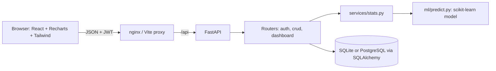
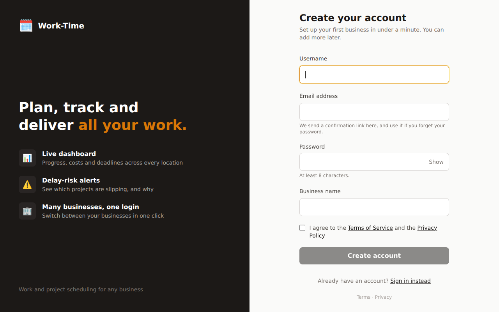
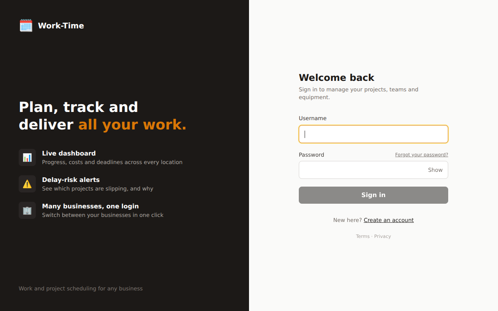
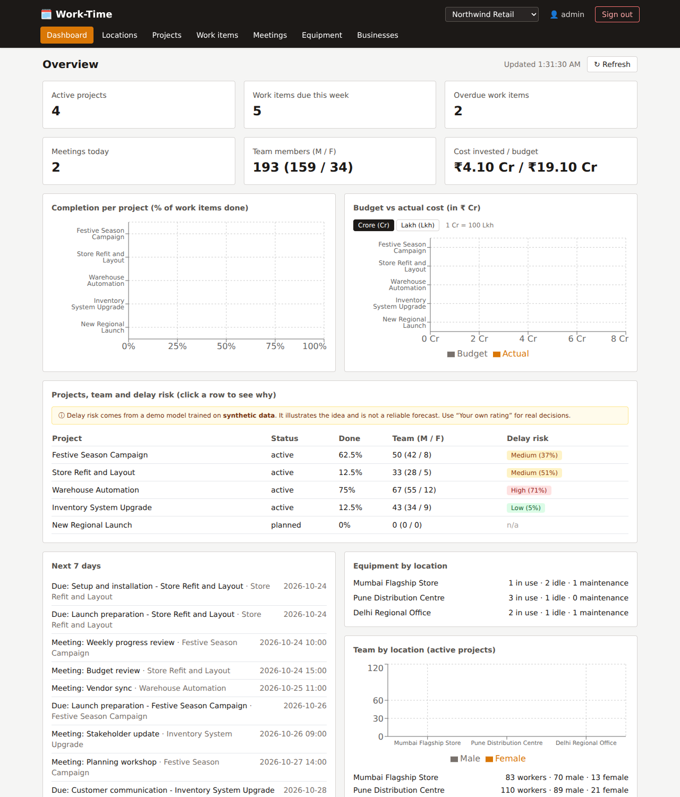
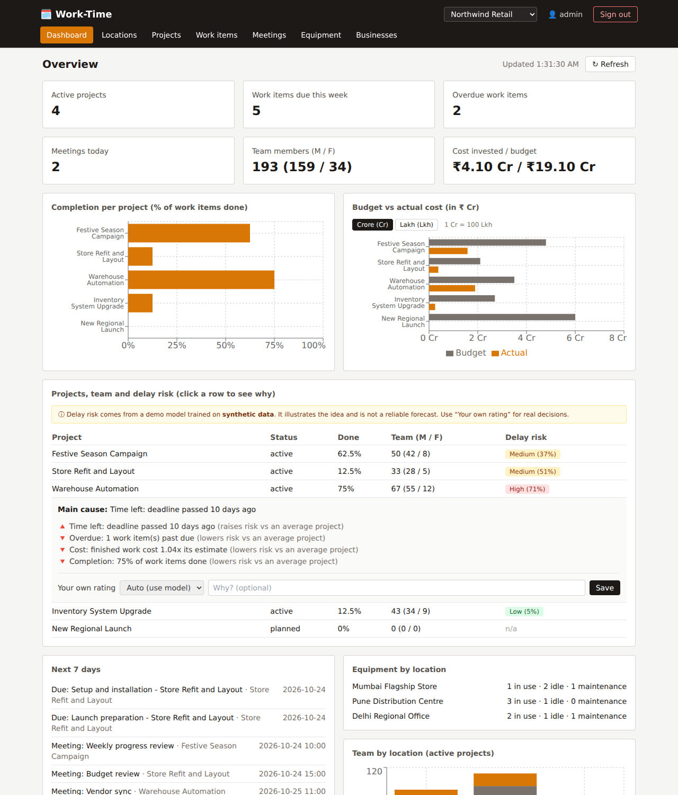
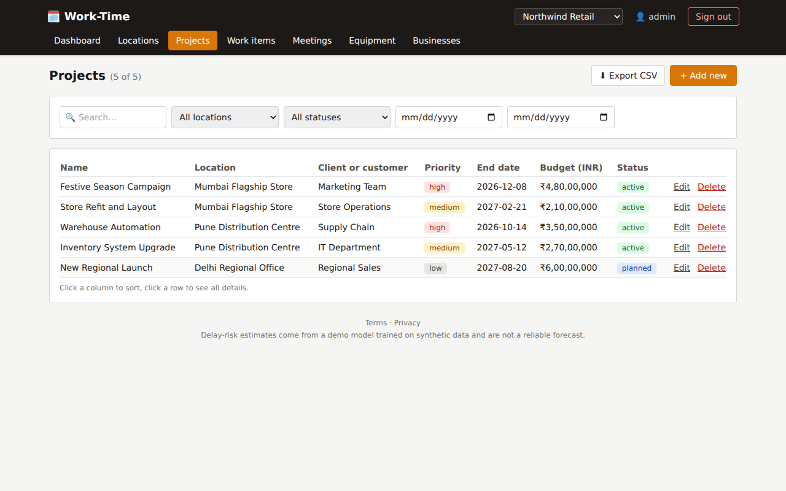
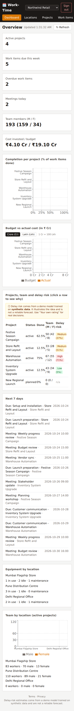

# Work-Time Scheduling Dashboard

> Created and maintained by **Soham Raut**. Open source under the [Apache License 2.0](LICENSE). Contributions are welcome: see [CONTRIBUTING.md](CONTRIBUTING.md).

A full-stack dashboard for managers who track work items, meetings, costs, teams and equipment across any number of locations and businesses, with a delay-risk prediction for each active project.

> **Honesty note:** the ML model is trained on **synthetic data** I generated from a hand-written formula. It shows the pipeline (features → model → API → UI), not real-world predictive power.

## Features
- Accounts done properly: email confirmation, password reset, change password, account deletion and data download, Terms and Privacy pages with recorded consent
- Sessions in an httpOnly SameSite cookie with CSRF protection (no token in browser storage)
- The delay-risk model's synthetic training data is disclosed in the app, the Terms and the API
- Production-ready deployment: HTTPS, PostgreSQL with migrations, rate limits, invite-only sign-up option. See [DEPLOY.md](DEPLOY.md).
- Multi-user, multi-business: people create their own accounts, each account can hold several businesses, and a header switcher changes the active one. Data is isolated per business.
- Secure login (JWT, brute-force lockout) and a dashboard of cards, charts, deadlines, equipment and workforce
- Budget vs actual cost with a Crore / Lakh switch
- ML delay-risk badge per project, with the main cause explained and a manual override
- Full CRUD for sites, projects, work items, meetings and machines with validation
- Search, sorting, filters (site, project, status, dates), CSV export, inline status changes
- Male / female workforce per project and per site

## Business data captured
Locations (manager, phone), projects (client, type, priority, description), work items (priority, cost), meetings (location, attendees), equipment (assigned person, last service date). UI: search, sortable columns, expandable detail rows, inline status change, CSV export, risk drill-down.
> The schema changed: after upgrading, run `python seed.py --reset` (SQLite has no migrations here; see "What I'd improve next").

## Architecture

Notable design choice: one generic CRUD router factory (`routers/crud.py`) serves all five resources, and one config file (`frontend/src/resources.js`) drives every CRUD page.

## Setup (without Docker)
```bash
cp .env.example .env                  # then edit SECRET_KEY and ADMIN_PASSWORD
cd backend
python -m venv venv && source venv/bin/activate
pip install -r requirements-dev.txt
python -m app.ml.train                # trains and saves the model (also auto-runs on first use)
python seed.py                        # admin user + demo data
uvicorn app.main:app --reload         # API on :8000, docs at /docs
# new terminal
cd frontend && npm install && npm run dev   # UI on :5173
```
Log in with `ADMIN_USERNAME` / `ADMIN_PASSWORD` from your `.env` (default username `admin`).

## Tests
```bash
cd backend && pytest          # 46 API/ML/seed/migration/credit tests (in-memory SQLite, no setup needed)
cd frontend && npm test       # 35 Vitest tests (sign-up, sign-in, reset, legal pages, account deletion, dashboard, forms)
```

## Windows (PowerShell) quick start
Needs Python 3.12 (`winget install Python.Python.3.12`) and Node.js LTS.
```powershell
copy .env.example .env; notepad .env           # set SECRET_KEY (16+ chars) and ADMIN_PASSWORD
cd backend; py -3.12 -m venv venv; venv\Scripts\Activate.ps1
pip install -r requirements-dev.txt; python seed.py
cd ..\frontend; npm install; cd ..
powershell -ExecutionPolicy Bypass -File .\start-dev.ps1   # opens both servers + browser
```
Restore demo data any time: `cd backend; python seed.py --reset`.
`APP_TIMEZONE` (default `Asia/Kolkata`) controls what "today" means on the dashboard.

## Setup (Docker)
```bash
cp .env.example .env
docker compose up --build             # UI http://localhost:8080, API http://localhost:8000/docs
```
SQLite data persists in the `db_data` volume. To use PostgreSQL, uncomment the `DATABASE_URL` Postgres line in `.env`, then:
```bash
docker compose --profile postgres up --build   # if the backend starts before Postgres is ready it restarts automatically
```

Optional end-to-end test (drives the real UI code against a running, seeded backend):
```bash
cd frontend && E2E_API=http://127.0.0.1:8000 E2E_USER=admin E2E_PASS=<your password> npm test
```
GitHub Actions (`.github/workflows/ci.yml`) runs backend tests, frontend tests + build, and builds and smoke-tests the Docker stack on every push.

## Deploying publicly
See **[DEPLOY.md](DEPLOY.md)** for the step-by-step guide (`docker-compose.prod.yml`, automatic HTTPS, backups). The compose file in the root (`docker-compose.yml`) is for a local demo only: it seeds demo data and uses SQLite.

## API summary
All routes except `POST /api/auth/login` require `Authorization: Bearer <token>`. Interactive docs: `/docs`.

| Method | Path | Purpose |
|---|---|---|
| POST | `/api/auth/login` | form fields `username`, `password` → JWT |
| GET/POST | `/api/{sites,projects,work-items,meetings,machines}` | list (filters: `site_id`, `project_id`, `status`, `date_from`, `date_to`) / create |
| GET/PUT/DELETE | `/api/{resource}/{id}` | read / update / delete (404 if missing; deletes cascade) |
| GET | `/api/dashboard` | cards, chart data, next 7 days, equipment, risk per project |
| GET | `/api/projects/{id}/risk` | delay probability, Low/Medium/High, input features |
| GET | `/api/health` | liveness check |

Also: `POST /api/auth/register` (new account + first business), `GET/POST /api/businesses`, `PUT/DELETE /api/businesses/{id}`. Every data route needs an `X-Business-Id` header naming one of your own businesses (otherwise 400/404). The UI calls `/sites` "Locations" and `/machines` "Equipment"; the API keeps the technical names.

## ML: delay-risk prediction
- **Model:** `StandardScaler` + `LogisticRegression` (scikit-learn pipeline). Chosen because it is explainable and gives calibrated-ish probabilities.
- **Features:** completion %, days remaining, cost overrun (actual ÷ estimate on finished items), overdue item count.
- **Data:** `app/ml/train.py` generates 5,000 synthetic projects; the label is drawn from a logistic formula plus noise. The holdout metrics it prints therefore measure how well the model recovers *my formula*, not reality.
- **Output buckets:** probability < 0.33 Low, < 0.66 Medium, otherwise High.
- Only `active` projects get a badge.
- **Why this risk?** For each factor the dashboard shows its push on the model's log-odds relative to an average synthetic project (coefficient x standardized value). The largest positive push is shown as the main cause. It explains the model, not reality.
- **Your own rating:** a manager can override the model per project (Low/Medium/High plus a note). It is shown as `manual`; the model's estimate stays visible in the detail panel.
- **Workforce:** male/female headcount is stored per project; site totals sum the active projects.

## Screenshots
Captured from the real app with the seeded demo data.

| First visit: create account | Returning visit: sign in |
|---|---|
|  |  |
| **Dashboard** | **Delay risk, with the main cause explained** |
|  |  |
| **Projects** | **Phone-sized screen** |
|  |  |

## What I'd improve next
- Replace synthetic data with real historical project data and validate the model properly (time-based split, calibration).
- Alembic migrations instead of `create_all`; refresh tokens and multiple users/roles.
- Pagination on list endpoints; end-to-end browser tests (Playwright); a dashboard query that aggregates in SQL instead of Python.
- Move JWT from `localStorage` to an httpOnly cookie.

## Contributing, security and policies
- [CONTRIBUTING.md](CONTRIBUTING.md): how to help, and how contributions are licensed and credited
- [SECURITY.md](SECURITY.md): report vulnerabilities privately; known gaps
- [CODE_OF_CONDUCT.md](CODE_OF_CONDUCT.md)
- [PRIVACY_POLICY.md](PRIVACY_POLICY.md) and [TERMS_OF_SERVICE.md](TERMS_OF_SERVICE.md): templates for anyone who runs their own copy (the software itself sends nothing to its author)
- [CHANGELOG.md](CHANGELOG.md)

## License and credit
Released under the **Apache License 2.0** (see [LICENSE](LICENSE) and [NOTICE](NOTICE)). Plain-English summary, not legal advice:
- You may use, copy, change, and even sell this software.
- **You must keep the copyright notice, the LICENSE and the NOTICE file**, and you must say which files you changed.
- Copying the code and removing the author's name breaks the license.
- The license gives no right to use the author's name or the "Work-Time" name as your own brand.
- The software comes "as is", without warranty.

The original author is credited in `NOTICE`, in a short header at the top of every source file, in this README and in the app footer. Contributors keep authorship of their own contributions, recorded permanently in the Git history, and license them under Apache 2.0 (section 5). Every source file carries the author and licence in a short header, and a test checks it. If you build on this project, please also link back to this repository.

Third-party packages and their licences are listed in [docs/THIRD_PARTY_LICENSES.md](docs/THIRD_PARTY_LICENSES.md).
